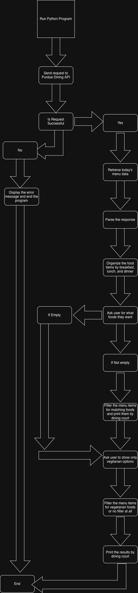

# Purdue-Menu-Filter

Filters the purdue dining hall menus.

## The Problem

I'm solving the problem of having to scroll through all the purdue menu items for each dining hall to find out if some item is there. It can become tedious to do this everyday, especially if you want specific items and want some items that are vegetarian.

## How It Works

The program follows these steps: 

1. Connects to the Purdue Dining API
2. Parses the JSON response
3. Organizes the food data by each dining hall
4. Allows users to have the option to search for specific foods
5. Allows users to show only vegetarian items
6. Prints the matching food items by each dining court



## Tech Stack

- **Language:** Python
- **Libraries:** `requests` for API requests and getting the menu data
- **External tools:** Purdue Dining API. https://tyhoffman.com/blog/2013/04/purdue-dining-court-api/ 

## Setup

Step-by-step: how does someone who just cloned your repo get it
running?

```bash
git clone https://github.com/Saketh-Parimi/Purdue-Menu-Filter
cd Purdue-Menu-Filter
python (or python3 on mac) -m venv venv
source venv/bin/activate
pip install requests
```

## Usage

How to actually run the thing, with examples.

```bash
python Purdue-Menu-Filter
```

## Roadmap

Features you haven't built yet but plan to (pull these from your
"Schedule" quadrant in the Eisenhower Matrix).

- [ ] Add vegan and other dietary restrictions
- [ ] Add option to add allergens
- [ ] Allow users to select dates
- [ ] Allow users to choose breakfast, lunch, and dinner
- [ ] Save food items
- [ ] Build a mobile app or website

## Author

Saketh Parimi, https://github.com/Saketh-Parimi
